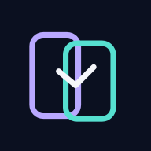

<div align="center">
  
  <h1>Nurva</h1>
  <p><strong>Your screens. Connected.</strong></p>
  <p>A shared wallpaper space for Android devices — at home or miles apart.</p>
  <p>
    <a href="https://github.com/noisais/Nurva/actions/workflows/ci.yml"></a>
    <a href="https://github.com/noisais/Nurva/actions/workflows/nurva-foundation-ci.yml"></a>
  </p>
</div>

## What Nurva is

Nurva is an Android-first project for keeping wallpapers consistent across groups of devices, including devices that are not on the same Wi-Fi network. It is being built on the open-source Wall You wallpaper engine while replacing its original app experience with a Nurva-specific interface and shared-device features.

## Current app experience

- **Home** — shared-space overview and shortcuts.
- **Groups** — email account, create or join a group, issue Editor/Viewer invitations, inspect member roles and registered devices, and revoke device access.
- **Explore** — browse the existing wallpaper sources.
- **Library** — favorites and recently applied wallpapers.
- **Settings** — account/device management, appearance, wallpaper behavior, cache, backup/restore, and About.

## Implemented foundation

- Local Room storage for groups, members, devices, revisions, themes, schedules, and a sync outbox.
- Per-group device credentials encrypted with Android Keystore.
- Supabase email/password sign-in with encrypted local session storage.
- Authenticated RPCs for group creation, invite creation, joining, sync-state reads, and device revocation.
- Role-aware device roster and invite-link deep links.
- Supabase migrations and PostgreSQL smoke tests.

Cloud account and group features require a configured Supabase project. See [the setup guide](docs/NURVA_GROUPS_SETUP.md).

## Roadmap

- [ ] Wallpaper upload and download across devices.
- [ ] WorkManager-powered offline queue processing and automatic reconnect sync.
- [ ] Optional approval before remote wallpaper application.
- [ ] Per-device wallpaper targets and automatic application.
- [ ] Multi-device mosaic creation and distribution.
- [ ] Shared themes and scheduled changes.
- [ ] Invite QR codes and improved account recovery flows.

## Build

The Android app uses Gradle and JDK 17. From the repository root:

```bash
./gradlew testDebugUnitTest assembleDebug
```

For live account/group functionality, follow [Supabase setup](docs/NURVA_GROUPS_SETUP.md). Never put a Supabase secret/service-role key in the Android app. Only the publishable client key belongs in a client build.

## Open-source foundation

Nurva retains the GPL-3.0 license obligations and upstream notices from [Wall You](https://github.com/you-apps/WallYou). See the repository's license file and the app's About page for project links and attribution.
